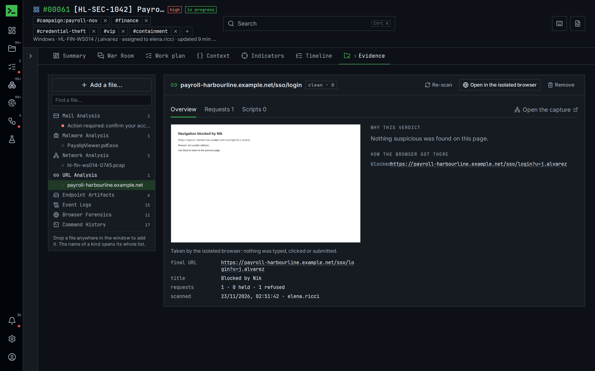
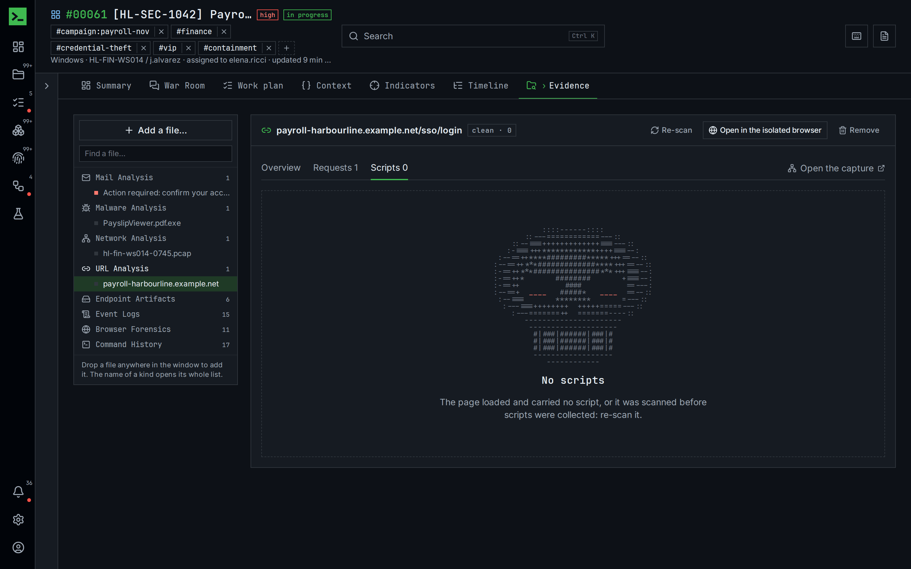

# Links

Check a link from an e-mail or a chat: the isolated browser visits it for you and Nik says whether it looks like phishing, and why.

!!! note "What a visit does"
    The isolated browser runs on the server, with access to the internet but never to your own network. It types, clicks and submits nothing. The site sees a visit from the server's address.

## Scan an address

Any of these starts a scan:

- **Evidence › URL Analysis**: type the address in **Address to scan** and press **Scan**.
- **New analysis** in the **Artifacts** panel: **or an address to scan**, then **Scan address** (no incident).
- Paste the address on the app (++ctrl+v++) and choose **Analyse URL**. See [Paste or drag text](evidence.md#paste-or-drag-text).
- Right-click a URL or a domain anywhere: **Analyse URL**.
- Select addresses on the Indicators page: **Analyse the addresses…**. See [The Indicators page](indicator-library.md#addresses-to-analyse).

Defanged text works: `hxxps://payroll-harbourline[.]example[.]net`. A domain is visited as `https://<domain>/`. An address already scanned is recognised and not visited twice: **Re-scan** visits it again.

The address shows **scanning…** while the browser visits it, then its verdict and score. The picture comes from an isolated test stack: the visit was blocked as *not a public address*, so it shows no phishing verdict, forms or redirects. A real look-alike page fills the parts below.

## What you get

**Overview**:

- The **screenshot** of the page, taken by the isolated browser.
- The facts: **final URL**, **title**, **server** (its address), **certificate** (issuer, issued when), **requests** (how many, held, refused), **scanned** (when, by whom).
- **WHY THIS VERDICT**: each finding with its points.
- **HOW THE BROWSER GOT THERE**: every redirect, shorteners included.
- **FORMS ON THE PAGE**: each form, where it sends, and **asks for a password** when it does.

**Requests** lists the requests of the visit, and **Open the capture** opens them as a capture in [Network Analysis](network.md#isolated-browser-sessions).

**Scripts** shows the scripts of the page. See [Scripts](#scripts).

## The verdict

Findings weigh points, as in [Mail Analysis](mail.md#the-verdict).

| Score | Verdict |
|---|---|
| 70 or more | **phishing** |
| 40 to 69 | **suspicious** |
| less than 40 | **clean** |

What counts:

- the address: a look-alike of a brand, punycode, an `@` in the address, an IP address as host, a throwaway top-level domain, a shortener, a page hosted on a cloud service;
- a page that asks for a password outside the brand's own domains (worse over plain http, or under a brand's name in its title);
- a form that sends what is typed to another domain;
- a chain of redirects through three domains or more;
- a certificate issued less than seven days ago;
- a download the page started;
- what the [scripts](#scripts) do.

An address that could not be visited says **not visited**, with the reason.

## Scripts

The scripts the page loaded and those written in it, read as text, never run, each checked against Nik's signatures. A page with none says **No scripts**, as in the picture.

1. The list is sorted worst first.
2. Select a script: what was found (credentials sent to a Telegram bot, a password field read and sent out, a keylogger, obfuscation, a miner…), with **Show in the code** to jump to the match.
3. A well-known library says **Recognised as …**.
4. **Beautified** lays minified code out a line per statement (only white space changes). Copy the code, or download it in a zip, password `infected`.

What the scripts do counts in the verdict, and the addresses they talk to join the incident's indicators (not those of a recognised library). A script is kept up to its first 300,000 characters.

!!! info "Script signatures"
    The signatures are in **Platform settings › Rule sets › Script signatures** (the **rules** role, or an admin): a regular expression, a severity, and its points. Changes apply to scans made from then on: **Re-scan** an address to read it again.

## Look by hand

**Open in the isolated browser** opens the page in a window you drive. Choose **No network** or **Allow internet for this session** first. See [The isolated browser window](#the-isolated-browser-window).

## The isolated browser window

The window is the same as for e-mail attachments: see [The isolated browser window](mail.md#the-isolated-browser-window) for its toolbar, its network choice, held submissions, tabs and full screen.

- The page is drawn at the size of the space it has: a large monitor shows a large page.
- A window the page opens (a sign-in pop-up, a new tab) appears as a tab above the page. When a pop-up closes itself, you are back on the page that opened it.
- Downloads are refused and reported; alerts and permission prompts are dismissed.

!!! warning
    Never type real credentials in a phishing page, even with network allowed.

## Act on an address

| Action | Where |
|---|---|
| **Re-scan** | The head of the address: visits it again and replaces the result. |
| **Remove** | Takes the address out of this incident; it stays as an artifact. |
| **Scan again**, **Open as an artifact**, **Remove from the incident** | Right-click the address in the list. |

The address, the hosts it led to and the server's address join the incident's [Indicators](indicators.md); the scan joins its timeline and report. Nik's own verdict also counts in the reputation of the indicator, as the source **Nik's analysis**, when it flags the value.

## Related

- [Add evidence](evidence.md)
- [E-mail](mail.md), where most links come from
- [Network capture](network.md)
- [The Indicators page](indicator-library.md)
- [How URL analysis works](../reference/architecture.md)
