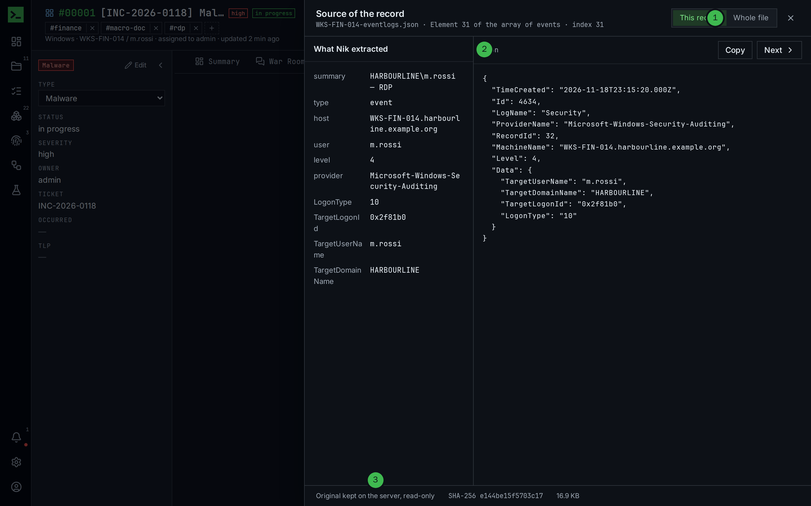

# Source viewer

From a record to the place it came from in the original file, and back.

Every record of a host page has a **Source** action in its row. It opens the viewer on the right of the screen.

## A record and its original

1. Press **Source** on a row. The title says the file and the place in it.
2. **This record** shows two things side by side: **What Nik extracted** 2, the fields the parser kept, and the original: the XML of an EVTX record, the line of a CSV or of a log, the row of a SQLite database, the registry key, the MFT entry.
3. **Copy** copies the original. **Next** goes to the next record of the rows on screen.
4. The footer 3 says that the original is kept on the server, read-only, with its SHA-256 and its size.
5. **Whole file** 1 leaves the record and shows the file.

A file imported before 7.0 has no original: the viewer says so.

## The whole file

1. Press **Whole file**.
2. The file is shown as text, or as hex when it is binary, in pages of 64 KiB. Move from page to page.
3. Type an offset in **Go to offset** (`0x1A00` or `6656`) and press Enter to jump there.
4. Search the whole file for text (UTF-8 or UTF-16) or for hex bytes. Each hit is an offset.

The viewer reads the original on the server, through the worker. Nothing of the file is run.

## Download the original

**Download original**, in the parse report of the file, gives the file back in an encrypted zip with the password `infected`. It needs the permission `evidence.download` (the role **Evidence**), and each download is written to the audit log. See [Host evidence](host.md#the-sources-table-and-the-parse-report).

## Related

- [Host evidence](host.md)
- [Event Logs](eventlogs.md)
