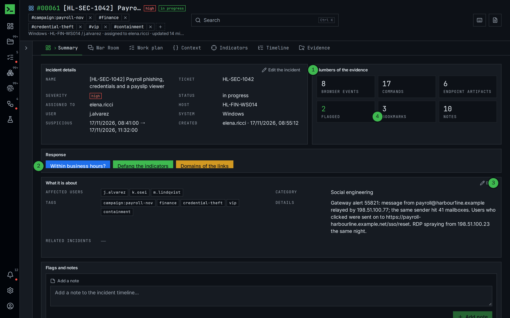
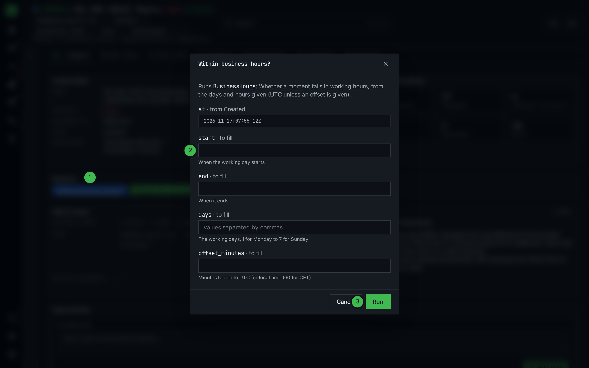
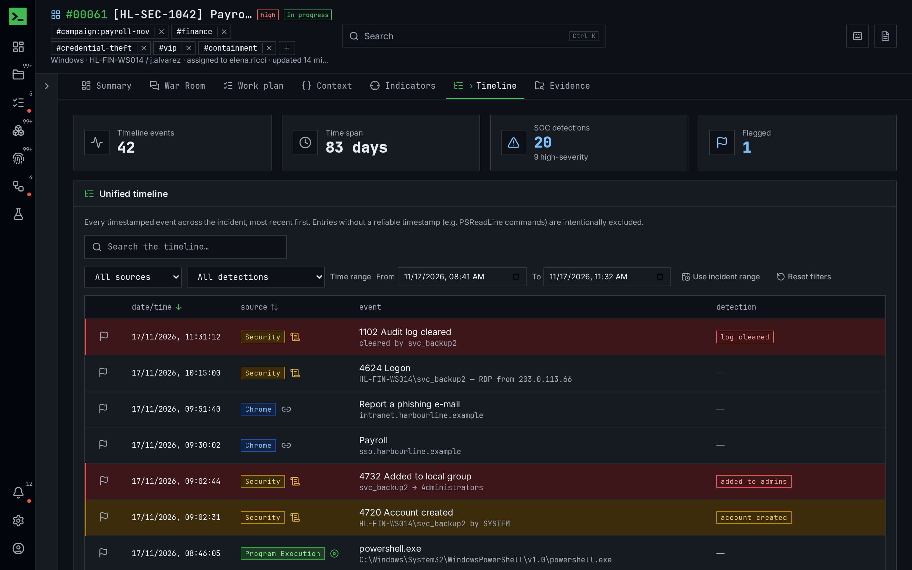
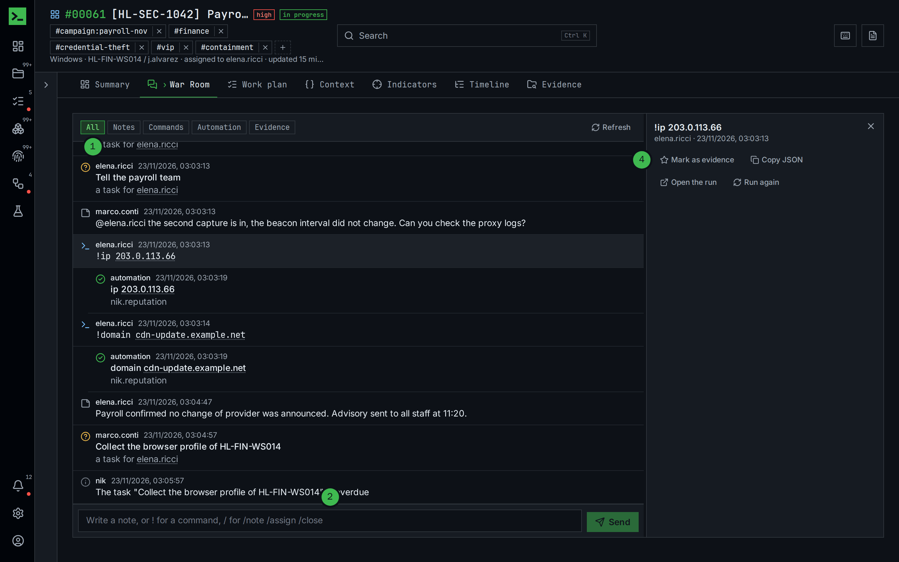
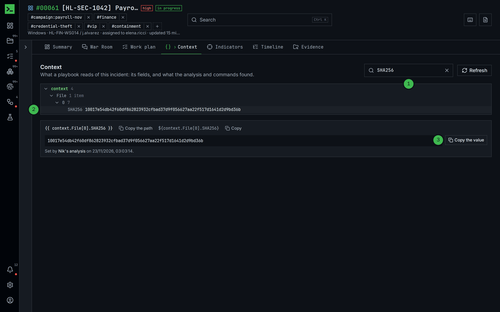

# Summary, timeline and War Room

Read an incident at a glance, follow what happened in order, and keep one log of what your team said and did.

An incident has these tabs. Its type can reorder them, hide some and add pages of its own ([Types, fields and pages](types.md)).

| Tab | Holds |
|---|---|
| **Summary** | The page of its type: details, fields, numbers, flags and notes. |
| **War Room** | Everything said and done on the incident, and its command line. |
| **Work plan** | Its tasks, and what its playbooks do step by step. [Your first playbook](playbooks.md) |
| **Context** | What playbooks read of the incident. Needs the right to run playbooks. |
| **Indicators** | Every indicator found in its evidence. [Indicators of an incident](indicators.md) |
| **Timeline** | Every timestamped event of its evidence, in order. |
| **Evidence** | Its files, each in the page of its kind. [Add evidence](evidence.md) |

## The Summary

The Summary is a grid of widgets, arranged for the type as a dashboard is. The picture shows the Phishing type of incident #00061:

- **Incident details** 1: name, ticket, severity, status, owner, host, user, system and the suspicious window. **Edit the incident** changes them.
- **Script buttons** 2, here titled **Response**: buttons that run a script on the incident (see below).
- **The sections of its type** 3, each with its fields and an **Edit** button.
- **Numbers of the evidence** 4: counters per kind of evidence, flags and notes.
- **Flags and notes**, at the foot: what was flagged and written, in order of time.

Incident details, Numbers of the evidence, the sections and Flags and notes come out of the box. A type can add more widgets: **Timers** (SLA), **Evidence**, **War Room**, **Work plan**, **Indicators**, **Script buttons**, **Chart of a dashboard**, **Linked incidents**, a text of its own. Administrators arrange them: see [Types, fields and pages](types.md).

- **Chart of a dashboard** shows one widget of a dashboard narrowed to what this incident holds for one field: a chart of incidents by day becomes the incidents **on this host** by day. An incident with nothing in that field shows no chart, and says so.
- **Linked incidents** lists up to ten incidents linked to this one: those named in its **Related incidents** field (and those that name it), then those that share indicators with it, most shared first. Allowlisted values link nothing.

## Flags and comments

Flag what matters: it is listed on the Summary and goes into the [report](reports.md).

1. Right-click a row (an event, an e-mail, a sample, an indicator, a packet…).
2. Choose **Flag the …**, or press ++f++ with the pointer on the row.
3. To say why, choose **Add a comment…**, or press ++c++. The row is flagged too.

To unflag, right-click › **Remove the flag**, or press ++f++ again. Removing a flag removes its comments; the notice has **Undo**.

A flagged sample, e-mail, capture or address shows a small flag in its list. On the Summary, the same menu removes a flag or adds a comment.

## Script buttons

A **Script buttons** widget holds up to eight buttons, each running a script on the incident.

1. Click a button 1. A dialog shows every argument: those filled from the incident (read-only, with their field) and those to fill.
2. Fill in what is asked 2.
3. Click **Run** 3.
4. The dialog lists the runs as they finish: done with the time it took, or failed with the reason. **Run the failed one again** starts only those.

A field that holds several values runs the script once for each: the dialog says `3 runs, one for each value` and the button reads **Run 3 times**. Above 50 runs it asks a second time.

Each run is a command in the War Room, written as it would be typed, with its result under it.

!!! note "You need"
    The right to run playbooks (Analyst or Playbooks). For others the buttons are greyed and say why.

??? info "Set up the buttons"
    Click the pencil of the widget. For each button choose its text, the colours of the button and of its text (a warning shows under a 4.5 : 1 contrast), the script (one with a saved version), and what each argument receives: leave it empty to ask at run time, or write `{{ sender_address }}` to fill it from that field. Typing `{{` offers the fields of the type, and `incident.number`, `incident.host`, `incident.user`. Text can stand around an expression: `INC {{ incident.number }}`. Join the values of a multi-value field with `| join(", ")`. See [Scripts and the Playground](scripts.md).

## The Timeline

Every timestamped event of the evidence in one list, in order: browser visits and downloads, commands, endpoint artifacts, Windows events, samples, e-mails, network captures.

- Filter by source, by text or by severity.
- Events the detection engine finds suspicious are marked.
- Events inside the incident's suspicious window stand out.
- Right-click any flaggable item elsewhere › **Show in the Timeline** opens it filtered on that item.

The Timeline is the forensic timeline of the evidence. What people did is in the War Room.

## The War Room

The log of the incident: notes, commands and their results, each step a playbook ran on it, approvals answered, in the order they happened.

- **The chips** 1: **All**, **Notes**, **Commands**, **Automation**, **Evidence** keep one kind.
- **The line** 2 at the bottom: write a note, or a command.
- **An entry** 3: click it to open it beside the stream: a result as a table when it is one, what a step was given and sent, what was **Written to the context**, and for a fetched alert **The item as it came**. Each box has a button that copies it whole.
- **Mark as evidence** 4, in an open entry, tags it `evidence`; the **Evidence** chip shows those.

### Write in it

| Type | Does |
|---|---|
| Plain text | A note of the incident. The same note shows on the Summary and in the report. |
| `/note text` | The same. |
| `/assign @elena.ricci` | Gives the incident to elena.ricci. `/assign` alone: to nobody. |
| `/close` | Opens the form that closes the incident. |
| `/task Call the user @elena.ricci due=2h` | Adds a task to the work plan, for elena.ricci, due in two hours. |
| `!ip 203.0.113.66` | Runs a command: what is known of an address. |
| `@elena.ricci` in a note | Tells elena.ricci by the bell. |

The name of a command is completed while you type and its arguments are hinted. A command that changes something outside asks **Run this command?** first. Commands need the right to run playbooks; see [War Room commands](commands.md).

A note written by a playbook is marked **automation** and signed `nik-automation`; the mark opens the run that wrote it.

Right-click an entry › **Open the entry**, **Open the run**, **Copy the text**, **Copy the command**, **Copy as JSON**.

### Notes on the Summary

Notes appear in **Flags and notes** on the Summary too. Point at one for **Edit note** and **Remove note**.

## The Context tab

The **Context** is what playbooks read of the incident, as a tree: its fields, and the files, e-mails, addresses, tickets and hosts known for it.

1. Type in **Find a key or a value…** 1 to narrow the tree.
2. Click a value 2. Under the tree you see the path to write in a playbook and who set it: Nik's analysis, a connector, a run.
3. Copy what you need 3:

| Button | Copies | Example |
|---|---|---|
| **Copy the value** | The value: a text as it is, a branch as JSON | the SHA-256 itself |
| **Copy the path** | The path as a playbook writes it | `{{ context.File[0].SHA256 }}` |
| **Copy the path for the command line** | The path as the War Room line writes it | `${context.File[0].SHA256}` |

The same three copies are in the right-click menu of every row. The tree shows a long value on one line, cut; **The value, whole** box and the copy hold all of it, and you can select text in either.

A key that is not a plain word is written in brackets: `context.ext["check-point"]["a key"]`; an item of a list by its number.

With the keyboard: ++tab++ reaches the tree, the arrows walk it (++right++ opens a branch, ++left++ closes it), ++enter++ chooses, ++ctrl+c++ copies the value of the row when no text is selected.

!!! note "You need"
    The right to run playbooks (Analyst or Playbooks). Without it the tab is not shown.

## Related

- [Work an incident](incidents.md)
- [War Room commands](commands.md)
- [Indicators of an incident](indicators.md)
- [Types, fields and pages](types.md)
- [Reports and exports](reports.md)
- [Scripts and the Playground](scripts.md)
