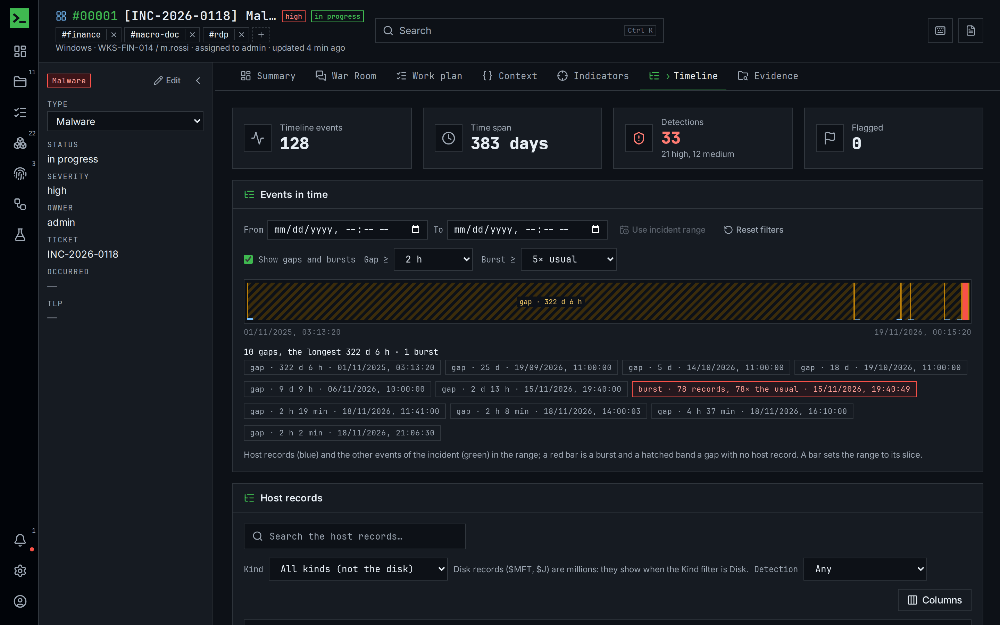

Self-hosted · source-available

# Work an incident as a team, from first alert to report.

Open an incident, drop the evidence, read it on one timeline, automate the routine and hand over a report. Everything stays on your server.

[Install in 5 minutes](get-started/install.md){ .md-button .md-button--primary }
[Open the user guide](guide/index.md){ .md-button }

## Where do you start?

-   **I work incidents**

    ---

    - [Your first incident in 10 minutes](get-started/first-incident.md)
    - [Analyse an e-mail](guide/mail.md), [a sample](guide/malware.md), [a capture](guide/network.md), [a link](guide/url.md)
    - [Read the files of a machine](guide/host.md): [event logs](guide/eventlogs.md), [a triage collection](guide/collections.md)
    - [Indicators: find, check, share](guide/indicators.md)
    - [Detection with Sigma rules](guide/detection.md#sigma-rules)
    - [Act on many incidents at once](guide/bulk.md)
    - [Write your first playbook](guide/playbooks.md)

-   **I run the server**

    ---

    - [Install with Docker or Podman](admin/install.md)
    - [Users, roles and sign-in](guide/accounts.md)
    - [Connect your tools: Jira, SentinelOne, mail…](guide/connectors.md)
    - [Backups, recovery and a standby host](admin/backups.md)
    - [Upgrade to a new version](admin/upgrades.md)

-   **I build on Nik**

    ---

    - [A playbook from scratch](guide/build/playbook.md)
    - [A Python script](guide/build/script.md)
    - [Your own integration](guide/build/connector.md)
    - [A content pack](guide/build/pack.md)
    - [The API](reference/api.md)

## What Nik does

-   **Incidents and timeline**

    One case per incident, every event on one timeline, a War Room for what was said and done.

    [Incidents →](guide/incidents.md)

-   **Mail analysis**

    Headers, SPF/DKIM/DMARC, links and attachments of a reported e-mail, with a verdict.

    [E-mail →](guide/mail.md)

-   **Malware analysis**

    Static analysis, YARA, capa and a disassembler. Samples are never executed.

    [Malware →](guide/malware.md)

-   **Host evidence**

    Event logs, registry, Prefetch, `$MFT`, browser history and whole triage zips, kept as given and read in an isolated worker. Every record opens its original.

    [Host evidence →](guide/host.md)

-   **Detection**

    Sigma rules run on every record as a file is read; write your own and try them on an incident.

    [Detection →](guide/detection.md)

-   **Network and links**

    Captures read by Wireshark's engine; links visited by an isolated browser.

    [Network →](guide/network.md) · [Links →](guide/url.md)

-   **Indicators**

    Found in what comes in, checked against threat intelligence, exported as CSV, STIX or MISP.

    [Indicators →](guide/indicators.md)

-   **Playbooks**

    Drawn on a canvas: triggers, conditions, approvals, Python in a sandbox.

    [Automation →](guide/playbooks.md)

-   **Connectors and mirroring**

    Fetch from Jira, ServiceNow, SentinelOne or a mailbox, and keep both sides in step.

    [Connectors →](guide/connectors.md)

-   **Safe by default**

    Two-factor sign-in, an encrypted store, a signed audit log, backups that test themselves.

    [Security →](reference/security.md)

## New in 6.10

Select many incidents, artifacts or indicators and act on them at once; indicators found by themselves in what comes in; mirroring on everything that fetches. [Read what changed →](changelog.md)
