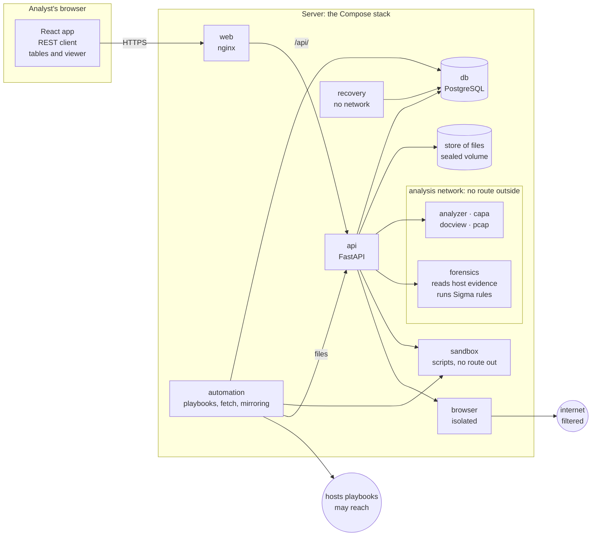
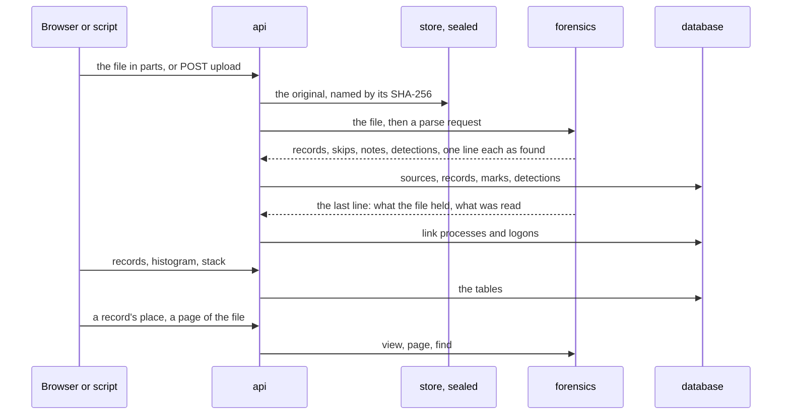

# Architecture

How Nik is built: what runs where, the services, the data model, and how each analysis works.

## The design

- **Every file goes to the server, as it was given.** Samples, e-mails, captures, mailboxes and, from 7.0, the files of host evidence (event logs, registry hives, a `$MFT`, browser databases, histories, Linux and macOS logs). Nothing of these is read in the browser any more. The server keeps each file under its SHA-256 and has the right worker read it.
- **Host evidence is read by the forensics worker.** It parses each file in a process of its own, counts what the file holds by itself, says what it could not read, runs the Sigma rules on the records as they come, and shows the place of a record in its original. The backend writes what it says into tables.
- **State lives on the server.** Incidents, accounts, settings and the audit log are in the database; the browser keeps only view preferences.
- **One origin.** nginx serves the app and proxies `/api/`, so there is no CORS and the session cookie just works. In development the Vite proxy plays nginx's role.
- **Hostile content goes to the least privileged part** ([Security](security.md#containment)).

The API is one FastAPI application with a router per area (`backend/app/routers/`), all under `/api`.

## The services

What each container does and its ports: [Install in production](../admin/install.md#the-services).

| Network | Who is on it | Route outside |
| --- | --- | --- |
| `default` | `db`, `api`, `automation`, `web` | — |
| `analysis` | `api`, `analyzer`, `capa`, `docview`, `pcap`, `forensics` | No (internal) |
| `browser-control` | `api`, `browser` | No (internal) |
| `browser-egress` | `browser` | Yes, through its filtering proxy |
| `automation-internal` | `api`, `automation`, `sandbox` | No (internal) |
| `automation-egress` | `automation` | Yes: playbooks, connectors, backup copies, syslog |

`recovery` has no network at all: it shares the PostgreSQL socket with `db` on the volume `db-socket`.

| Volume | Holds | Mounted by |
| --- | --- | --- |
| `db-data-18` | The database | `db` |
| `sample-store` | The store of files, sealed | `api` only |
| `backups` (or `NIK_BACKUP_DIR`) | Encrypted backups and upgrade snapshots | `api`; `automation` read-only |
| `wal-archive` (or `NIK_WAL_ARCHIVE_DIR`) | Log segments and base backups, in clear | `db`, `recovery`, `api`; `automation` read-only |
| `db-socket` | The PostgreSQL socket | `db`, `recovery` |
| `pcap-work`, `pst-work` | A large capture, a PST, while read | `pcap`, `docview` |
| `forensics-work` | The originals the forensics worker is reading, in clear, until nobody asks for them for 15 minutes | `forensics` |
| `web-certs` | The TLS certificate | `web` |

## The data model

| Store | Content |
| --- | --- |
| `incidents` | The incident documents (flags, notes, references to samples, e-mails, captures, scans), some fields mirrored into columns, a revision counter, its time zone and, when archived, `archived_at` and `archived_by`. **Not** the records of host evidence |
| `evidence_sources` | One row for each file of host evidence an incident holds: its SHA-256, section, parser and its version, state, **parse report** (in the file, read, kept, duplicates, skipped, notes), whether it was read in part and whether somebody has seen it, and the collection it came from |
| `evidence_records` | One row for each record read: a stable natural **key**, its section, source, type, time, host, user, channel, event id, summary, data and its **locator** (where it is in the original) |
| `evidence_marks` | The flags and notes on records, by key: they outlive a new reading of the file |
| `evidence_detections` | A Sigma rule that matched a record (one row for the pair) |
| `evidence_processes`, `evidence_logons` | The process tree and the logons of the lateral graph, linked after a file is read |
| `evidence_members` | The files the worker found in a collection |
| `sigma_rules` | The rules host evidence is matched against, their checks, and the pack each came from |
| `upload_sessions` | Files being sent in parts |
| `backup_blobs`, `backup_blob_refs` | The pool of the backups: which file of the store each backup names, and where its copy off the server stands |
| `ioc_index` | The indicators of every incident, rebuilt when its evidence changes |
| `samples`, `sample_code`, `sample_functions`, `sample_capa`, `function_annotations` | The analysis of each sample |
| `mails`, `network_captures`, `url_scans` | The analysis of each e-mail, capture and scanned address |
| `artifacts`, `artifact_links`, `artifact_relations` | The registry of everything analysed, which incidents reference it, what came out of what |
| `artifact_jobs`, `artifact_job_parts` | What a playbook asked the backend to do with a file |
| `yara_rules`, `flirt_signatures`, `capa_rules` | Rule sets added by admins |
| `ioc_enrichment`, `leases`, `work_claims` | Answers of the sources; who holds each loop and each piece of work |
| `bulk_jobs`, `bulk_items` | Bulk actions and each item's outcome (kept a month) |
| `users`, `sessions`, `api_keys` | Accounts (bcrypt), server-side sessions, keys (SHA-256 digest) |
| `audit_log` | The audit chain |
| `settings`, `webhooks`, `jobs`, `idempotency_keys` | Shared settings, subscriptions, background uploads, replay protection |
| `recovery_bases`, `store_copies` | Base backups, and where each store file's copy stands |
| The store (a volume) | Samples and e-mails named by SHA-256, **the originals of host evidence** (`_evidence/<sha256>.bin`), parts of files being sent (`_uploads/`, in no backup), captures (`_captures/`), screenshots (`_urls/`), previews (`_previews/`), rule files; deleted files kept for a recovery (`.kept/`) |

An incident document holds identity fields (`ticketId`, `title`, `host`, `username`, `name`), `severity`, `status`, `assignee`, the suspicious window, timestamps, and `data` with one key per evidence kind registered in `frontend/src/config/tabs.js`, plus `flags` and `notes`. From 7.0 the keys `eventlogs`, `endpoint`, `browser` and `commands` are empty: that evidence is in the `evidence_*` tables. Every timestamp of an entry is Unix epoch in milliseconds. The full JSON is in [Developer guide](developer.md#the-incident-json-format).

**Saving.** The app updates its state at once and sends only the difference as a JSON Merge Patch (RFC 7396), one save at a time, with `If-Match`. The backend bumps the revision at every write under a row lock. On 412 the app reads the server's version and merges its changes over it, item by item for lists with an identity (notes, comments). A failed save is retried; an expired session asks for the password and resumes.

## How each analysis works

??? info "Malware samples"
    The file is posted to `POST /api/incidents/{id}/samples`, written once to the store as `<sha256>.bin`, and analysed statically (`parsing/malware.py`: hashes, type, entropy per 64 KB block, strings, indicators). Executables are parsed (`parsing/executables.py`: PE with pefile, ELF and Mach-O with Nik's own parsers); malformed headers become warnings. Every sample is scanned with YARA: the built-in rules under `app/malware/yara/` plus those admins add. **Re-analyse** runs the current engine again. The same file in two incidents is stored and analysed once. Downloads are wrapped in an AES-256 zip.

??? info "Code view and capabilities"
    The backend never runs rizin. It queues a job and sends the sample to the `analyzer` worker (rizin with rz-ghidra), which lists functions, their calls and basic blocks, and decompiles for up to `ANALYZER_DECOMPILE_SECONDS` (entry point and main first, then non-library functions). The rest are decompiled when opened; an analysed session is kept warm (`ANALYZER_WARM_SESSIONS`) so that takes seconds. A rizin crash on one function is retried once, then the function is skipped. Each function's graph and pseudo-C is a row of `sample_functions`, fetched one at a time. capa runs in its own worker, one sample at a time.

??? info "Mail"
    `.eml` with the standard library, `.msg` with olefile (attached messages three levels deep). The `Received` chain is read in travel order; `Authentication-Results` are believed only from your own servers (**Mail analysis** settings). DKIM, SPF and DMARC are verified through DNS (3 s timeout; a failure reads `temperror`). Links are unwrapped from Safe Links, Proofpoint, Google, Facebook and Barracuda redirects; look-alikes of brands and of your domains are found by folding confusable characters. The HTML is cleaned with nh3 and shown in a sandboxed frame. Attachments: type from magic bytes, macros (oletools), zip listings, PDF actions, QR codes. Each finding weighs points; 70 or more is phishing, 40–69 suspicious.

??? info "Threat intelligence"
    A source is a connector, and a look-up is the command of its file marked `reputation` for that kind of indicator, run on the oldest instance that is on. Commands marked premium, that change something outside, or that carry a file are never chosen. Keys of an instance take turns; one at its limit or refused with 429 is skipped. Nik has no code of its own for any vendor: the sources come as content packs.

??? info "Previews and the isolated browser"
    `docview` converts Office, OpenDocument and RTF to PDF with LibreOffice (fresh profile, macros disabled, links never updated, killed after 90 s) and renders the first 20 pages with pdfium; the browser receives PNG only. The isolated browser runs Chromium under Playwright; the analyst sees a JPEG of the viewport and their clicks and keys are replayed in the worker. Without network only the attachment loads; with network every connection goes through the worker's proxy, which refuses private addresses and pins the address it checked. WebRTC and QUIC are off. Up to eight tabs; a session closes after 5 minutes idle (30 at most).

??? info "Network captures"
    pcap or pcapng (gzip too) up to `PCAP_MAX_MB`, stored under `_captures/`. The `pcap` worker reads it once with tshark for the summary (hosts, DNS, HTTP, TLS names, POSTs, beacons, exported objects, Expert Info), then serves the packet list, protocol tree, Follow Stream and Export Objects through sharkd (two captures open at most, closed after 15 minutes). TLS is decrypted with a key log stored encrypted. An isolated browser session's network log is rebuilt as a pcapng and analysed the same way, and exports as HAR.

??? info "Addresses"
    The isolated browser opens a session with network, takes a screenshot and reads the page's forms, then closes; nothing is typed, clicked or submitted. Findings weigh points (look-alike, punycode, a password asked outside the brand's domains, a form posting elsewhere, a fresh certificate…); 70 or more is phishing, 40–69 suspicious. The page's scripts are read as text, never run, and matched against script signatures. One row per distinct address; scanning again replaces it.

## Host evidence, inside

- **The worker never sees the store.** It is given the file it must read and keeps it in clear on `forensics-work` until nobody asks for it, and no longer than its next start.
- **One process for each file**, with memory and CPU time bounded. If a file crashes a parser, that process ends and the file is reported as read in part, with what was read before. The worker answers busy when `FORENSICS_MAX_JOBS` are running, and the backend waits.
- **Where detection runs.** In the worker, on the full values of each record as the parser gives it. Rules are picked by log source, compiled the first time a record can reach them, and the four correlations run at the end of the file. The backend gives the worker a set of rules by its SHA-256. pySigma only reads and validates a rule, in a short process of its own; Nik's evaluator runs it. The process tree is linked after the file is done, and the **process-chain** rules run on it then.
- **A match is a row** of `evidence_detections`, a level on its record, a line in the War Room for a file with detections of medium or more, and the trigger `evidence.detected`.
- **Tables, not the document.** Every page asks the server for a page of rows with its filters. A record has a key that does not change when the file is read again: flags and notes are kept by key.
- **Archive.** Archiving a closed incident deletes its records and keeps its sources, originals, reports and marks; taking it out has the files read again.
- **Records of before 7.0** were moved from the documents to the tables by the API process, in the background, and are marked `legacy`: they have no original and no report.

## Recovery to a moment, inside

- `db`'s entrypoint (`deploy/db-entrypoint.sh`) gives PostgreSQL its archive settings on the command line: `deploy/db/wal-archive.sh` compresses each finished segment into the archive volume.
- `recovery` (the database image with `deploy/db/recovery-agent.sh`) takes base backups, proves the archive in a scratch server and applies the retention, each when the backend leaves a request file in the archive volume.
- The API process runs the archive pass under a lease; the `automation` worker sends segments, base backups and store files (asked of the API one by one) to the second host.
- Before the snapshot and migrations, the `api` entrypoint runs `python -m app.recovery.gate`: on a standby (a database in recovery) it stays there, answers every request with a sentence and takes in what arrives; when promoted, the server starts in the same container.
- `deploy/restore.sh --to` and `deploy/standby.sh` do on the host what only the host can (stop containers, put a base backup in place) and leave everything else to `python -m app.recovery.tool` in a container.

## Related

- [Security](security.md) — how the parts are kept apart
- [Install in production](../admin/install.md#the-services) — the services and ports
- [Developer guide](developer.md) — the folders and how to extend them
- [API](api.md)
